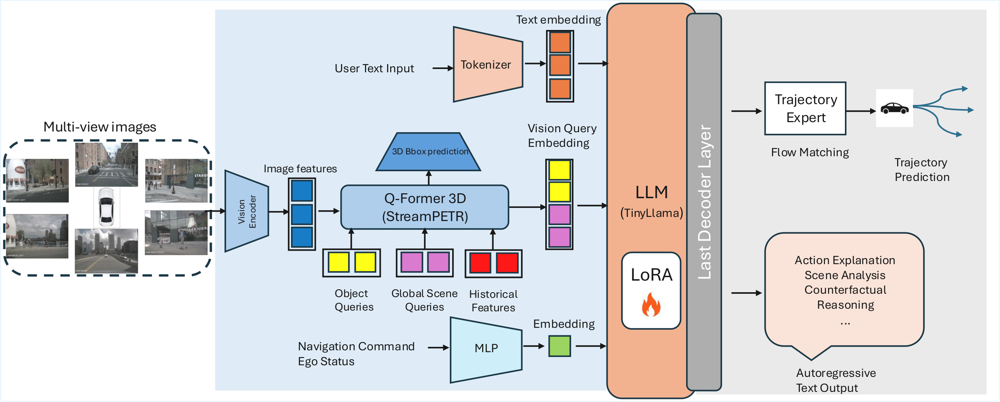
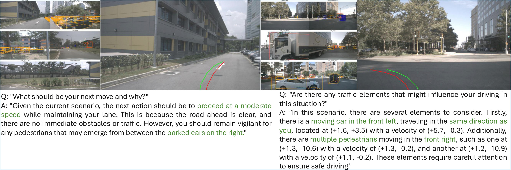
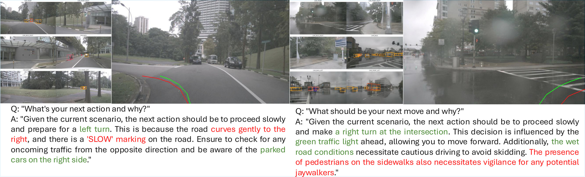

# SmallDrive: An Efficient Vision-Language-Action Model for Autonomous Driving via Flow Matching

**GCPR 2026** · [🤗 Model weights](https://huggingface.co/atanas1054/SmallDrive)

SmallDrive is a lightweight Vision-Language-Action (VLA) model that combines high-level semantic reasoning with fast trajectory generation. It builds on [OmniDrive](https://github.com/NVlabs/OmniDrive) with two core changes:

1. **Flow-matching trajectory expert.** A transformer-based conditional flow-matching head is conditioned on the last-layer hidden states of a small LLM (TinyLlama 1.1B). Planning is decoupled from autoregressive text decoding: a trajectory needs only a single LLM prefill pass plus 10 Euler steps of a light expert. Detailed language explanations remain available on demand.
2. **Condensed visual tokens.** The Q-Former3D compresses multi-view image features into 256 global scene tokens plus the **top-50 object tokens** (query feature + 3D box + score) from the auxiliary detection head. This replaces OmniDrive's 256 lane tokens and reduces the visual context from 512 to 306 tokens.

On nuScenes, SmallDrive matches state-of-the-art open-loop planning accuracy and does best on turning scenarios. Inference is about **10x faster** than its autoregressive counterpart (0.36 s vs. 3.33 s) and about **14x faster** than OmniDrive.

## Architecture

<div align="center">

</div>

Multi-view images are encoded by EVA-02-B. A Q-Former3D (StreamPETR) with global scene queries, object queries and a temporal memory bank produces the visual tokens. These tokens are fed to TinyLlama (LoRA) together with an ego-status/navigation-command token and the user prompt. The LLM can generate text autoregressively, while its hidden states condition the flow-matching trajectory expert that predicts the future trajectory.

## Main Results

### nuScenes open-loop planning (val set, ST-P3 metrics)

| Method | L2 (m) 1s ↓ | 2s ↓ | 3s ↓ | Avg. ↓ | Collision (%) 1s ↓ | 2s ↓ | 3s ↓ | Avg. ↓ |
|---|:-:|:-:|:-:|:-:|:-:|:-:|:-:|:-:|
| *Non-VLM methods* | | | | | | | | |
| ST-P3 | 1.33 | 2.11 | 2.90 | 2.11 | 0.23 | 0.62 | 1.27 | 0.71 |
| VAD | 0.17 | 0.34 | 0.60 | 0.37 | 0.07 | 0.10 | 0.24 | 0.14 |
| Ego-MLP | 0.15 | 0.32 | 0.59 | 0.35 | **0.00** | 0.27 | 0.85 | 0.37 |
| UniAD | 0.44 | 0.67 | 0.96 | 0.69 | 0.04 | 0.08 | 0.23 | 0.12 |
| BEV-Planner | 0.16 | 0.32 | 0.57 | 0.35 | **0.00** | 0.29 | 0.73 | 0.34 |
| *VLM-based methods* | | | | | | | | |
| DriveVLM | 0.18 | 0.34 | 0.68 | 0.40 | 0.10 | 0.22 | 0.45 | 0.27 |
| GPT-Driver | 0.20 | 0.40 | 0.70 | 0.44 | 0.04 | 0.12 | 0.36 | 0.17 |
| RAG-Driver | 0.34 | 0.37 | 0.69 | 0.40 | 0.01 | **0.05** | 0.26 | **0.10** |
| EMMA | **0.14** | 0.29 | 0.54 | 0.32 | - | - | - | - |
| OmniDrive | **0.14** | 0.29 | 0.55 | 0.33 | **0.00** | 0.13 | 0.78 | 0.30 |
| Senna | 0.37 | 0.54 | 0.86 | 0.59 | 0.09 | 0.12 | 0.33 | 0.18 |
| ORION | 0.17 | 0.31 | 0.55 | 0.34 | 0.05 | 0.25 | 0.80 | 0.37 |
| OpenDriveVLA | **0.14** | 0.30 | 0.55 | 0.33 | 0.02 | 0.07 | **0.22** | **0.10** |
| **SmallDrive (Ours)** | **0.14** | **0.28** | **0.50** | **0.31** | 0.02 | 0.11 | 0.31 | 0.15 |

### Turning-nuScenes open-loop planning (val set, UniAD metrics)

| Method | L2 (m) 1s ↓ | 2s ↓ | 3s ↓ | Avg. ↓ | Collision (%) 1s ↓ | 2s ↓ | 3s ↓ | Avg. ↓ |
|---|:-:|:-:|:-:|:-:|:-:|:-:|:-:|:-:|
| UniAD | 0.52 | 0.88 | 1.64 | 1.01 | 0.16 | 0.51 | 1.41 | 0.69 |
| VAD | 0.48 | 0.80 | 1.55 | 0.94 | 0.07 | 0.41 | 1.20 | 0.56 |
| SparseDrive | 0.35 | 0.77 | 1.46 | 0.86 | 0.04 | 0.17 | 0.98 | 0.40 |
| MomAD | 0.33 | 0.70 | 1.24 | 0.76 | 0.03 | 0.13 | 0.79 | 0.32 |
| ImagiDrive | 0.34 | 0.69 | **1.23** | 0.75 | **0.00** | 0.12 | 0.53 | 0.22 |
| OmniDrive | 0.21 | 0.73 | 1.82 | 0.92 | **0.00** | 0.17 | 1.03 | 0.40 |
| **SmallDrive (Ours)** | **0.20** | **0.59** | 1.38 | **0.72** | **0.00** | **0.00** | **0.17** | **0.06** |

### Inference time (single NVIDIA A100)

| Method | Inference time (s) ↓ | Avg. L2 (m) ↓ |
|---|:-:|:-:|
| OmniDrive | 5.0 | 0.33 |
| RAG-Driver | 4.0 | 0.40 |
| OpenDriveVLA | 1.35 | 0.33 |
| ORION | 1.25 | 0.34 |
| UniAD | 0.56 | 0.69 |
| SmallDrive (autoregressive trajectory) | 3.33 | 0.32 |
| **SmallDrive (flow matching)** | **0.36** | **0.31** |

## Qualitative Results

Each example shows the six surround-view images with 3D object detections (left) and the front camera with the predicted trajectory (green) and the ground-truth trajectory (red) (right). Below each example are the question and SmallDrive's answer.

**Correct textual outputs** (correct content marked in green):

<div align="center">

</div>

**Failure cases** (correct content in green, wrong content in red):

<div align="center">

</div>

The failure cases show two typical failure modes of current VLA models:
- **Visual grounding failures:** the LLM hallucinates elements, such as pedestrians that are not there, because of the compressed visual bottleneck.
- **Causal disconnect:** the predicted trajectory is a safe maneuver, but the text generated in parallel gives an incorrect or contradictory explanation.

## Getting Started

### Installation and data

Follow [docs/setup.md](docs/setup.md) to set up the environment (PyTorch 1.13, mmcv-full 1.6.2, mmdet3d v1.0.0rc6). It also covers downloading nuScenes, the OmniDrive-nuScenes annotations and the pretrained TinyLlama checkpoint.

### Pretrained SmallDrive checkpoint

The trained model used for the paper results is available on Hugging Face: [atanas1054/SmallDrive](https://huggingface.co/atanas1054/SmallDrive) (3.5 GB).

```bash
huggingface-cli download atanas1054/SmallDrive smalldrive_gcpr2026.pth --local-dir ckpts/
```

The commands below use `ckpts/smalldrive_gcpr2026.pth`. To evaluate a model you trained yourself, use `work_dirs/smalldrive/latest.pth` instead.

### Training

SmallDrive starts from OmniDrive's 2D-pretrained TinyLlama checkpoint (stage 1, LLaVA pretraining). It is then trained end-to-end on nuScenes with the detection, language and flow-matching losses (stage 2). The default config trains for 24 epochs on 4 GPUs with batch size 4 per GPU:

```bash
tools/dist_train.sh projects/configs/SmallDrive/smalldrive.py 4 --work-dir work_dirs/smalldrive/
```

The schedule is defined in iterations. If you use a different number of GPUs or a different batch size, update `num_gpus` and `batch_size` at the top of the config.

### Inference and open-loop planning evaluation

**1. Run inference** with the planning prompt. Set `generate_text=False` to get only the flow-matching trajectory (fast); predictions are written per sample to `./results/smalldrive/`:

```bash
tools/dist_test.sh projects/configs/SmallDrive/smalldrive.py ckpts/smalldrive_gcpr2026.pth 4 \
    --format-only --cfg-options model.generate_text=False
```

**2. nuScenes (ST-P3 metrics).** Use the `L2 (m), ST-P3` and `Collision (%)` rows of the output:

```bash
python evaluation/eval_planning.py --base_path data/nuscenes/ --pred_path results/smalldrive/
```

**3. Turning-nuScenes (UniAD metrics).** This uses the same predictions, restricted to the 680 turning samples of the [Turning-nuScenes](https://github.com/adept-thu/MomAD) validation split. Use the `L2 (m), UniAD` and `Collision (%)` rows:

```bash
python evaluation/eval_planning.py --base_path data/nuscenes/ --pred_path results/smalldrive/ \
    --tokens_file evaluation/turning_nuscenes_val_tokens.txt
```

To run inference only on the turning samples, add `model.eval_tokens_file=evaluation/turning_nuscenes_val_tokens.txt` to `--cfg-options` in step 1. Perception still runs on every frame, so the temporal memory is unaffected.

### Language evaluation (OmniDrive-nuScenes QA)

```bash
# scene description, action explanation and counterfactual QA, with text generation
tools/dist_test.sh projects/configs/SmallDrive/smalldrive_lang.py ckpts/smalldrive_gcpr2026.pth 4 --format-only

# BLEU / ROUGE-L / CIDEr (/ BERTScore)
python evaluation/eval_language.py --pred_dir results/smalldrive_lang/ --gt_dir data/nuscenes/vqa/val/

# LLM score: Gemma3-27B as a judge, served locally with Ollama (`ollama pull gemma3:27b`)
python evaluation/driveLM_eval_ollama.py --pred_dir results/smalldrive_lang/ \
    --actions_gt_dir data/nuscenes/vqa/val/ --model gemma3:27b
```

### Latency

```bash
python tools/profile_smalldrive_latency.py projects/configs/SmallDrive/smalldrive.py ckpts/smalldrive_gcpr2026.pth \
    --samples 100 --warmup 10
```

This prints a per-component breakdown (vision encoder, Q-Former, LLM prefill, trajectory generation) of the single-GPU forward latency.

### Configs

| Config | Description |
|---|---|
| `projects/configs/SmallDrive/smalldrive.py` | SmallDrive (paper model): 256 scene + 50 object tokens, flow-matching trajectory expert |
| `projects/configs/SmallDrive/smalldrive_lang.py` | Same model, test prompts for the language evaluation |
| `projects/configs/SmallDrive/smalldrive_mlp_traj.py` | Ablation: direct-regression MLP trajectory head |
| `projects/configs/SmallDrive/smalldrive_gru_traj.py` | Ablation: direct-regression GRU trajectory head |

Other ablations can be set with `--cfg-options`. For example, `model.pts_bbox_head.num_topk_objects=0` removes the object tokens, and `model.pts_bbox_head.obj_token_content=feat_only` (or `geo_only`) changes the object-token content.

## Acknowledgement

This codebase is built on [OmniDrive](https://github.com/NVlabs/OmniDrive), [StreamPETR](https://github.com/exiawsh/StreamPETR), [mmdetection3d](https://github.com/open-mmlab/mmdetection3d) and [LLaVA](https://github.com/haotian-liu/LLaVA). The flow-matching trajectory expert is inspired by [SmolVLA](https://huggingface.co/papers/2506.01844) and [π0](https://www.physicalintelligence.company/blog/pi0). The Turning-nuScenes split comes from [MomAD](https://github.com/adept-thu/MomAD). We thank the authors for releasing their work.

## License

SmallDrive is a derivative of OmniDrive and is released under the [NVIDIA License](LICENSE) (non-commercial, research and evaluation use only), as required by the OmniDrive license.
